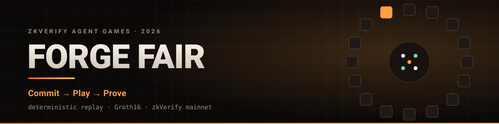
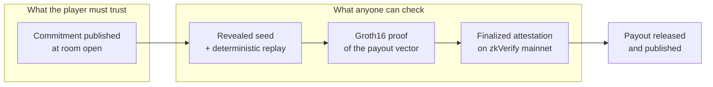
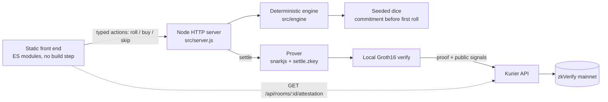
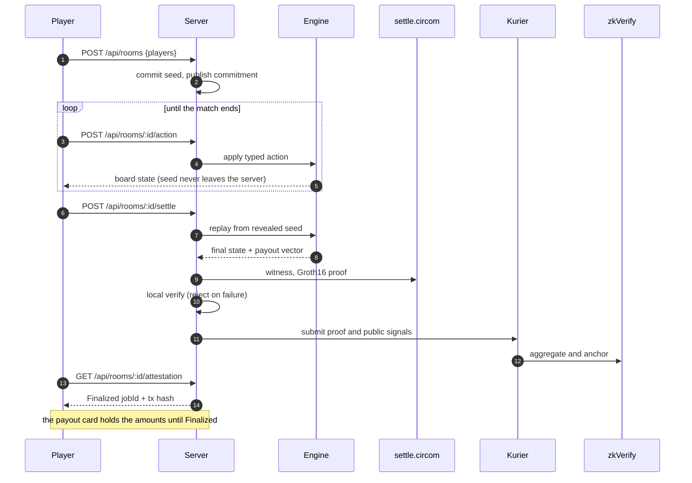

<p align="center">
  
</p>

<p align="center">
  <a href="https://forge-fair-eda0e7.azurewebsites.net"><b>Play it live</b></a> ·
  <a href="https://forge-fair-eda0e7.azurewebsites.net/#/watch">Watch a verified match</a> ·
  <a href="https://forge-fair-eda0e7.azurewebsites.net/#/proof">Proof page</a> ·
  <a href="audit/FORGE-FAIR-SPEC.md">Specification</a>
</p>

<p align="center">
  
  
  
  
</p>

# Forge Fair

A 16-tile property game for 2–4 seats whose settlement a player can **verify** instead of trusting the house.

A seed is committed before the first roll. The finished match is replayed from the revealed seed, and the
payout vector is proved with Groth16 and anchored on zkVerify mainnet — so every match leaves a public,
timestamped record that this payout existed and satisfied the rules before a single credit moved.

---

## The claim, layer by layer

| # | Layer | What it establishes |
| --- | --- | --- |
| 1 | **Committed seed** | The dice cannot be re-rolled after the board is visible. The commitment is published when the room opens; the seed stays server-side until settlement. |
| 2 | **Deterministic replay** | The final state and payout vector are exactly what the committed rules produce from that seed — recomputable by anyone holding the revealed seed. |
| 3 | **Groth16 circuit** (`app/circuits/settle.circom`, 3,312 constraints) | Payouts sum to the pot, no payout exceeds the cap, the paid seat is the true leader of the committed balances, and the settlement nonce is single-use. |
| 4 | **zkVerify mainnet** (Kurier) | A public, timestamped attestation that the proof was verified, reachable from the settlement card and from `GET /api/rooms/:id/attestation`. |



---

## Architecture



The server verifies every proof **locally** before it answers `POST /settle`; the zkVerify anchor is the
public receipt, not the gate the server relies on. The verification key is registered once at startup in the
background so settlement latency stays low.

---

## Settlement, end to end



---

## Screens

| Route | What it is |
| --- | --- |
| `#/` | Landing: the commit → play → prove loop. |
| `#/play` | Lobby for 2–4 seats, then the hotseat table. |
| `#/watch` | A real bot match replayed with commentary, then verified on demand. |
| `#/guide` | Rulebook: objective, turn, tiles, money, endgame, fairness, controls. |
| `#/proof` | The four verification layers, circuit facts and public signals. |

The table is saved in `localStorage`, so a refresh reopens the same match. Seat names are cosmetic and stay
on the client.

---

## API

| Method | Path | Notes |
| --- | --- | --- |
| `GET` | `/api/board` | The 16 tiles. |
| `GET` | `/api/circuit` | Circuit metadata: name, curve, constraints, public signals. |
| `POST` | `/api/rooms` | `{ players: 2..4 }` → room with every seat joined. |
| `GET` | `/api/rooms/:id` | Public room view. |
| `POST` | `/api/rooms/:id/action` | `{ type: 'roll' \| 'buy' \| 'skip' }`. |
| `POST` | `/api/rooms/:id/settle` | Replay, prove, pay out; reveals the seed. |
| `GET` | `/api/rooms/:id/attestation` | zkVerify job status for the settlement. |
| `POST` | `/api/demo` | `{ players, names }` → a bot match played to settlement, returned as narrated frames. |

`POST /api/demo` creates a real room and plays it to settlement on the server; the client only replays the
frames it receives, so watching cannot leak a future roll.

---

## Verification record

A finalized settlement on zkVerify mainnet, produced by this build:

| Field | Value |
| --- | --- |
| jobId | `98c68b29-e58c-11f1-838e-1e6a0d14f999` |
| transaction | `0x88c223d2a292fe3f45ba71529b7c3c62a6232a355020566a5c20674060459277` |
| block | `0x2c587a36742890c8f3923f046a7f6e1526c723e107034d0f458dcdf9abaa9255` |
| status | Finalized |
| finalized at | `2026-11-21T09:19:25Z` |

---

## Honest limits

- **No cross-match ledger or hash chain.** Each match publishes its own finalized reference. A chained
  ledger is designed in the specification and deliberately not built.
- **Hotseat only.** No remote seats, no wallets, no faucet; credits are a closed zero-sum score, so the
  verifiable path cannot be blocked by a testnet.
- **Rooms live in memory** and are lost when the service restarts.
- **The circuit does not replay the board.** It proves the money moved as committed — conservation, the cap,
  the true winner, single-use. The rules themselves are established by deterministic replay. The proof page
  states this in the same words.

---

## Run locally

```sh
cd app
npm install
npm start      # http://localhost:3000
npm test       # engine, replay, settlement, circuit and bot-match tests (21)
```

No build step: the browser loads ES modules directly, and the server is a single Node process.

---

## Repository map

```
.
├── app/                          the product
│   ├── circuits/settle.circom    the settlement circuit
│   ├── public/                   static front end (views, board, settlement card)
│   ├── src/engine/               deterministic game engine and seeded dice
│   ├── src/zk/                   prover, verifier, Kurier client
│   ├── src/server.js             HTTP API and room store
│   ├── test/                     engine, replay, circuit, server and demo tests
│   └── zk/                       settle.wasm, settle.zkey, verification_key.json
├── audit/
│   ├── FORGE-FAIR-SPEC.md        threat model, two-layer settlement, circuit design
│   ├── SUBMISSION-FORM.md        the submitted copy, field by field
│   ├── HISTORY-ARC-MONOPOLY.md   master case file of the predecessor audit
│   ├── VERIFICATION-RUN1-vs-RUN2.md
│   ├── AGENT-GAMES-FEASIBILITY.md
│   └── cf-api/                   Cloudflare API evidence (JSON responses)
├── docs/
│   ├── AZURE-SETUP.md            deployment identity and records
│   └── assets/                   banner and social preview
└── tools/cf_edge_audit.sh        GET-only audit reproduction script
```

---

## Where the threat model comes from

Forge Fair is a new build, but its threat model is not invented. It comes from an audit of a predecessor
project in the same catalogue: a deleted hosting project, a frozen Cloudflare Worker, and an 828-line backend
whose session, dice and ticket flows were reviewed end to end. The case file is in
[`audit/HISTORY-ARC-MONOPOLY.md`](audit/HISTORY-ARC-MONOPOLY.md); the raw API evidence is under
[`audit/cf-api/`](audit/cf-api/).

What that audit changed here:

| Finding in the predecessor | Consequence in Forge Fair |
| --- | --- |
| Payout depended on a backend that no longer existed | Settlement is replayed and proved; the reference is public |
| Endpoints that overwrote room state without authorization | No such endpoint: every state change is a typed action on a live room |
| CORS pinned to a dead origin, so the front end could not call its own API | Same-origin API, no third-party origin in the loop |
| Client-visible randomness risk | Seed committed before the first roll, revealed only at settlement |

---

## Documentation policy

1. **Language.** Every authored document, commit message and comment in this repository is in English, in a
   technical register. No other language is used.
2. **Evidence is quoted, not rewritten.** Raw API responses are preserved exactly as received; they are the
   only files exempt from authoring rules.
3. **Claims are bounded.** Anything designed but not built is labelled as such, in the README, the
   specification and the proof page.

---

## License

Application code and documentation: MIT. The recovered worker source and the predecessor's published front-end
snapshot are the property of their account owner. They are not redistributed in this repository and are held
outside it.
